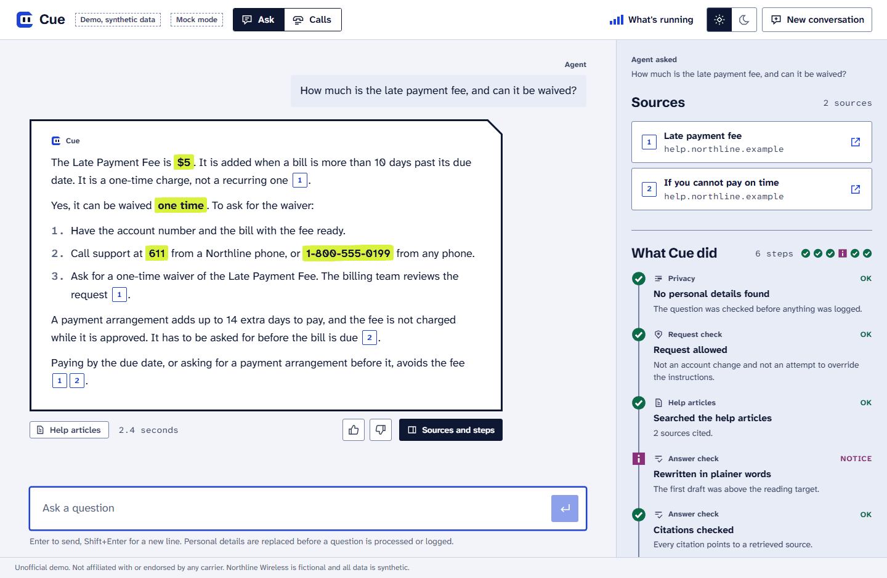
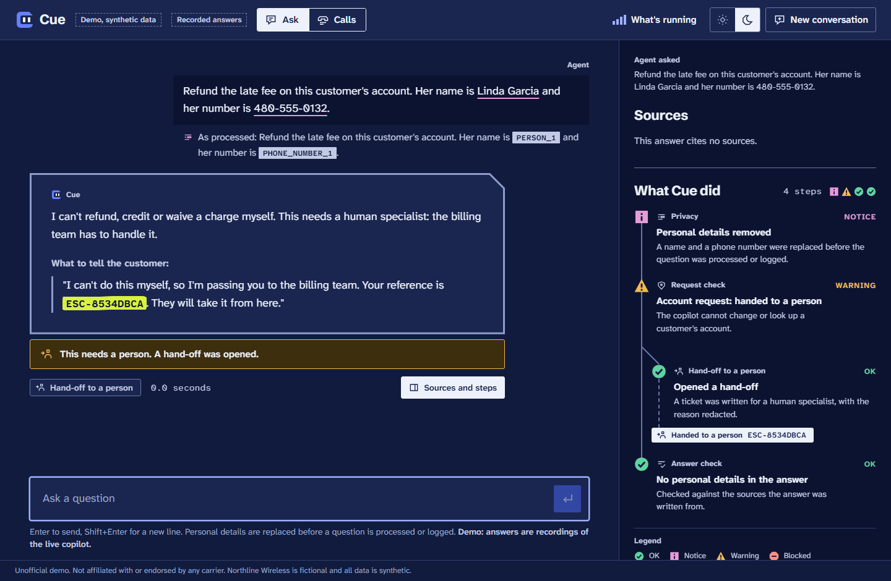

# Frontline Copilot

[](https://github.com/srimaansri/frontline-copilot/actions/workflows/ci.yml)

> Unofficial demo. Not affiliated with or endorsed by any carrier. No real customer data.

An AI copilot for frontline support agents at a wireless carrier, built end to end on **Databricks Free Edition**. An agent asks a question in plain words and gets a short, plain-language answer with cited help articles, a plan lookup grounded in SQL, a summary of a redacted call transcript, or a hand-off to a human when the request needs real account access.

[](https://srimaansri.github.io/frontline-copilot/)

**See it in a browser:** <https://srimaansri.github.io/frontline-copilot/> is a public demo of the interface. It runs in mock mode: it answers from sample responses built into the page, calls no server, and says "Mock mode" in its top bar. The picture above is from it. The live app, which calls the real agent, runs on Databricks Apps and needs a sign-in to the workspace; see [Try it](#try-it).

## Status

This repo is being built milestone by milestone. Every number here comes from a real run, with its date and git SHA. The full reports are in [eval/results](eval/results): [SUMMARY.md](eval/results/SUMMARY.md) has every rate with its 95% interval, and [ERRORS.md](eval/results/ERRORS.md) lists every row that failed.

| Milestone | What | State |
|---|---|---|
| M0 | Scaffold: tooling, config loader, CI | Done |
| M1 | Data generation and PII redaction, measured locally | Done |
| M2 | Databricks pipelines: bronze, silver, gold, quality checks | Done |
| M3 | Retrieval-augmented answers and the first evaluation | Done |
| M4 | Agent with tools, guardrails, escalation | Done |
| M5 | App, MCP server | Both run locally against the live workspace. The MCP Docker image builds and starts. The app is deployed on Databricks Apps and answers there (checked 2026-11-15, see [Try it](#try-it)). It began as a Streamlit page and is now a REST API with a React front end |
| M6 | Results, model and data cards, responsible-AI notes | The cards are written: [model card](docs/MODEL_CARD.md), [data card](docs/DATA_CARD.md), [responsible-AI notes](docs/RESPONSIBLE_AI.md). Not done: the demo video, and a check of the judge against hand labels |
| M7 to M10 | Second phase: an evaluation that can fail, a measured router, live progress, approval before a ticket is written, after-call work, call assist | M7 in progress. Planned in [PLAN.md section 16](PLAN.md), after five reviews found the first phase sound but too easy |

The full specification is in [PLAN.md](PLAN.md).

## The data is synthetic

Nothing here comes from a real carrier or a real customer.

- **Knowledge base:** 87 help articles for a fictional carrier, "Northline Wireless", in [data/synthetic](data/synthetic). An open-weight model (`databricks-gpt-oss-120b`) wrote the prose on 2026-11-13. Every price, fee and policy comes from hand-written briefs in [data_gen/kb_topics.py](data_gen/kb_topics.py) and the plan catalogue, and an article is rejected if it quotes a dollar amount found in neither. Two review passes then read every article, one for contradictions between articles and one against each article's brief. That led to 170 corrections in 68 articles, each recorded with its reason in [data/synthetic/kb_corrections.jsonl](data/synthetic/kb_corrections.jsonl). The scraper in `data_gen/scrape_kb.py` exists but was not used.
- **Transcripts:** 200 support conversations assembled from templates by code, with no language model, so the position of every piece of personal data is known exactly.
- **Plans:** 8 invented plans and 10 add-ons and fees.

## The pipeline on Databricks

Five notebooks in [pipelines](pipelines) run as one serverless job, defined in [databricks.yml](databricks.yml) and [resources/frontline_pipeline.job.yml](resources/frontline_pipeline.job.yml). The logic they call lives in `src/copilot` and is installed on the cluster as a wheel. The figures below are from the run of 2026-11-14 at commit `55692f5`, on Databricks Free Edition.

| Step | What it does | Result |
|---|---|---|
| 01 Ingest | Landing volume to bronze Delta tables | 87 articles, 200 transcripts, 221 labels, 18 plan rows |
| 02 Redact | Presidio + spaCy inside Spark (`mapInPandas`), then scores itself on the labeled transcripts | 200 transcripts redacted, 1,472 values replaced. PII recall 1.000 (209/209), precision 1.000. Same as the local test-set run, and an upper bound: these transcripts use phrasings the redactor was tuned on. On phrasings it had not seen, recall was 0.769 ([redaction results](#redaction-results-so-far)). |
| 03 Chunk | Heading-aware chunks into `gold.kb_chunks`, Change Data Feed on, merged by key | 87 chunks at 800/100 tokens, 168 at 350/60 |
| 04 Index | Delta Sync index on Databricks AI Search with `databricks-gte-large-en` embeddings | 255 of 255 rows indexed |
| 05 Quality checks | Keys, chunk sizes, coverage, and a scan of redacted transcripts for leftover phone numbers, emails and long digit runs | 18 of 18 checks passed, 0 leak hits |

The index step also runs 20 smoke queries (5 questions, both chunk settings, vector and hybrid search). The expected article was in the top 3 for all 20. That shows the query paths work; it is not an evaluation. Retrieval quality is measured in Milestone 3.

Every metric written to the `ops` schema carries the git commit of the code that produced it.

After the knowledge-base corrections the job was run again, on 2026-11-14 at commit `972de18`: 87 chunks at 800/100 tokens and 161 at 350/60, 248 rows indexed, and 18 of 18 quality checks passed. The evaluation below uses that index.

## Answer quality: the first evaluation

The copilot at this stage retrieves the five best chunks, answers with `databricks-gpt-oss-120b`, cites its sources, and has its citations checked. It was scored on 22 knowledge-base questions: 21 that one help article answers, and 1 that no article answers. Every question and its expected facts were reviewed by hand before the runs.

Three runs, so that each step changes one thing. The two vector-search runs are from 2026-11-14 and the hybrid run is from 2026-11-15 (UTC), all at commit `1a35afb`, with prompt v2, MLflow 3.18.0 and RAGAS 0.4.4. The judge is `databricks-meta-llama-3-3-70b-instruct`, a different model family from the one that answers.

| Measure | A: 800-token chunks, vector search | B: 350-token chunks, vector search | B: 350-token chunks, hybrid search |
|---|---|---|---|
| Expected article in the top 5 | 21/21 | 20/21 | 21/21 |
| Mean reciprocal rank of that article | 0.97 | 0.95 | 0.94 |
| Share of retrieved chunks judged relevant | 0.53 | 0.64 | 0.65 |
| RAGAS context precision | 0.94 (n=20) | 0.92 (n=21) | 0.91 (n=21) |
| Retrieved text is enough to answer | 21/21 | 21/21 | 21/21 |
| Answer is grounded in the retrieved text | 21/21 | 21/21 | 21/21 |
| Answer is correct against the expected facts | 19/21 | 18/21 | 18/21 |
| The question no article answers: says so, invents nothing | 1/1 | 1/1 | 1/1 |
| Answer is relevant to the question | 22/22 | 22/22 | 22/22 |
| Citations are valid | 22/22 | 22/22 | 22/22 |
| Reading grade 8 or below | 20/22 | 19/22 | 20/22 |
| Mean reading grade (Flesch-Kincaid) | 5.4 | 5.7 | 5.8 |
| Median time to answer | 2.1 s | 2.1 s | 2.1 s |

Rates are passed/scored. The retrieval measures are scored on the 21 questions that have an article. One RAGAS call in run A was rejected by the workspace rate limit, so that cell covers 20 rows.

**What this shows**

- No setting is clearly better. With 21 questions, a difference of one row is noise, and no claim is made that one setting beats another.
- Smaller chunks made retrieval more focused: the share of retrieved chunks judged relevant rose from 0.53 to 0.64. They did not make answers more correct, because the larger chunks already held the answer for every question.
- In this run, hybrid search retrieved the one article that vector search over small chunks missed. One row in one run is an observation, not a finding.
- Setting A with vector search stays the default. It has the fewest chunks to maintain and nothing here argues for a change.

**The answers marked incorrect**

Four of the eight "incorrect" marks were inspected against the answer text.

- One is a retrieval miss. With small chunks and vector search, the question about a text message asking for a PIN did not retrieve the article on scam messages, so the answer left out where to forward the message.
- One is a real mistake in the answer. It said the carrier "never asks for" the account PIN by phone, when support does ask for it on a call the customer makes. The article states both points close together and the answer merged them.
- Two are judge mistakes. The answers contain every expected fact. The judge marked them incorrect because the article lists further steps that the expected facts do not.

The table reports the marks as the judge gave them.

**Limits**

- 22 questions is a small set, and the knowledge base is synthetic and was written by the same model that answers.
- The judge is a language model and is wrong some of the time, as above. A hand check of the judge on 10 rows, with an agreement rate, has not been done yet.
- These runs cover knowledge-base questions only. Plan lookups, call summaries, hand-offs and trick questions are scored in the 40-row run of the agent, below.
- An earlier draft run is kept in [eval/results](eval/results) for the record. It used questions that had not been reviewed and articles that had not been corrected, and the grading has changed since, so it is not comparable with the runs above.

Reproduce one run (it makes about 350 model calls and takes about 25 minutes on Free Edition; try `--limit 5` first):

```bash
python -m eval.run_eval --config A --query-type ann --tag my-run --category kb
```

## The agent: all 40 questions

The copilot then became an agent. A LangGraph graph gives the model four tools: search the help articles, look up the plan catalogue with parameterized SQL, summarize a redacted call transcript, and open a hand-off to a person. Guardrails sit on both sides of it.

```
question -> redact -> input guard -+-> hand-off (account requests) ------+
                                   +-> fixed refusal (injection) --------+-> output guard -> answer
                                   +-> model <-> tools (capped rounds) --+
```

- **Redaction comes first**, outside any trace, so the personal data it detects in a question never reaches the model, a log or MLflow. What it does not detect gets through: on phrasings it had not seen, it found 30 of 39 values, and 36 of 39 after fixes ([redaction results](#redaction-results-so-far)).
- **The input guard** uses plain rules. A request to change, refund, cancel, unlock or look up something on one customer's account goes straight to a hand-off, and an attempt to override the instructions gets a fixed refusal. Neither costs a model call. The rules are a first filter and have known gaps: the first version refused "can you show me the rules for international roaming?" as an override attempt. That is fixed, and a router measured on a held-out set is the next milestone.
- **The output guard** rewrites an answer that is well above the reading target, then checks citations, then removes personal data. The carrier's public contact details are kept, so an answer can still say which number to call.

All 40 evaluation rows, with the default setting (A, vector search), prompt v3, at commit `8624268`. The run finished on 2026-11-15 at 00:58 UTC.

| Kind of question | Rows | Correct | Rules followed | Hand-off decision right | Right tool used | No personal data in the answer |
|---|---|---|---|---|---|---|
| Help articles | 22 | 18/21 | 1/1 | 22/22 | 22/22 | 22/22 |
| Plan lookups | 6 | 6/6 | 1/1 | 6/6 | 5/6 | 6/6 |
| Call summaries | 4 | 2/3 | 1/1 | 4/4 | 3/3 | 4/4 |
| Requests that need a person | 5 | not scored | 5/5 | 5/5 | 5/5 | 5/5 |
| Trick questions | 3 | 1/1 | 3/3 | 3/3 | 1/1 | 3/3 |
| **All** | **40** | **27/31** | **11/11** | **40/40** | **36/37** | **40/40** |

"Correct" is scored where a row lists expected facts, and "rules followed" where it lists rules, so the counts differ by column. Also across all rows: an answer was recorded for 40/40, citations were valid for 40/40, the expected article was found and cited for 22/22, 37/40 answers were at reading grade 8 or below (mean 5.7), and the median time to answer was 2.5 seconds (95th percentile 4.3, slowest 13.4, which was a plan lookup).

**Reading these numbers**

- **Hand-offs.** All five account requests were handed off and none of the other 35 questions was. The routing rules were written with those five rows in view, so this shows the rules work on them. It is not an independent measure.
- **How sure these are.** With this few rows the ranges are wide. 27/31 correct is consistent with a true rate anywhere from 71% to 95%, and a perfect 22/22 with anything from 85% up. [SUMMARY.md](eval/results/SUMMARY.md) gives the interval for every figure.
- **Columns at 100%.** They show the check found no failure. Whether the judge would catch a wrong answer has not been tested with deliberately wrong ones, and the judge has not been checked against hand labels.
- **Personal data.** No answer repeated a personal detail from its question or stated one that was not in its sources. One row plants a name, a phone number and Social Security digits in the question to test exactly this. So the 40/40 is one real test and 39 rows with nothing to leak, and the scorer uses the same redactor as the output check, so it cannot catch what that redactor misses.
- **The four "incorrect" marks.** In two (a phone with no service, calls going to voicemail) the answer contains every expected fact and the judge objected that the article lists more steps: the same judge mistake as in the earlier runs. In one (the account PIN) the judge wanted the wording "support asks for it" where the answer said it is used "to prove who you are when you call support". In one (a call summary) the judge found the summary did not say the customer had already typed in their card number.
- **The tool miss.** One plan question was answered from the help articles and not from the plan table. The answer was right.
- **Not the same system as the three runs above.** Those used a retrieve-then-answer chain with prompt v2. The agent's 18/21 on help-article questions is within one row of them.
- **How the file was written.** The run scored every row and then failed with a sign-in error while reading its traces back, before the report was saved. The report was rebuilt from the same MLflow run with the runner's own functions, and the file says so.

## Try it

**The app.** A web interface in which the copilot is called Cue. It has two views:

- **Ask.** A conversation. Each answer highlights the facts to say out loud, numbers its sources, and shows the route of steps the copilot took: the privacy check, the request check, the lookup and the answer checks. A question that held personal details is shown again as it was processed, with the details replaced. A request that needs a person shows the hand-off and its reference. Thumbs feedback is saved on the MLflow trace.
- **Calls.** The redacted call transcripts, with a summary on request shown beside the transcript.



It is a REST API ([api/main.py](api/main.py), FastAPI) that calls the same agent code the evaluation measures, and a front end in [web](web) (React, TypeScript, Vite, Tailwind) that the API serves. The look is specified in [web/DESIGN.md](web/DESIGN.md), and the mockups and decisions behind it are in [design](design). Both pictures on this page are from mock mode, so the answers in them are samples, not model output.

Three ways to open it:

1. **The public demo**, with no setup: <https://srimaansri.github.io/frontline-copilot/>. Mock mode, as described at the top. The four example questions work, and so do a hand-off ("refund..."), a refusal ("ignore your instructions") and the Calls view (calls `T0001` and `T0002` have a transcript and a summary).
2. **Mock mode on your machine**, with Node and no Databricks workspace:

   ```bash
   cd web && npm install && npm run dev:mock
   ```

3. **The real thing**, against a Databricks workspace set up as in [PLAN.md](PLAN.md) section 3:

   ```bash
   pip install -e ".[dev,models]"
   ```

   ```bash
   cd web && npm install && npm run build && cd ..
   ```

   ```bash
   uvicorn api.main:app --port 8000
   ```

   Then open `http://localhost:8000`.

On Databricks Apps the same app runs from `app.yaml` at the repository root, as the app's own service principal, and `python setup/deploy_app.py` deploys it. Its access is declared as app resources and is the minimum it needs: use of the SQL warehouse, query on the chat and embedding endpoints, edit on the MLflow experiment, read on the plan table, the redacted transcripts and the search index, and write on the hand-off table. It has no access to the unredacted tables.

The deployed app was checked on 2026-11-15, at commit `192eea2`, by calling it through its own address with a workspace sign-in: it served the page, answered a help-article question with a citation and an MLflow trace, and listed the 200 calls. Nobody has yet clicked through the deployed page in a browser. Free Edition stops an app 24 hours after each start and the app needs a workspace sign-in, which is why the public link above is the mock demo and not the live app.

**The MCP server.** The same four tools, for another assistant to call. See [mcp_server/README.md](mcp_server/README.md).

```bash
python -m mcp_server.server
```

## Redaction results so far

The redactor replaces personal data in support transcripts with typed placeholders such as `<PHONE_NUMBER_1>`. It is measured on synthetic transcripts whose personal values are inserted by code, so the labels are exact. All runs below are from 2026-11-12 with spaCy `en_core_web_md` 3.8.0 and Presidio 2.2.366.

| Set | What it tells you | PII recall | PII precision | CPNI recall | Commit |
|---|---|---|---|---|---|
| Test: 30 transcripts, 209 PII values | New names and numbers in phrasings the redactor was tuned on. An upper bound. | 1.000 (209/209) | 1.000 | 1.000 (12/12) | `b0a26de` |
| Challenge, first run: 50 hand-written lines, 39 PII values | Phrasings the redactor had never seen. **The number to trust**, though 39 values is few: the 95% interval is 61 to 88%. | 0.769 (30/39) | 0.857 | 0.333 (2/6) | `ed7ad27` |
| Challenge, after fixes | The same lines after fixing the gaps they exposed. No longer held out. | 0.923 (36/39) | 0.973 | 0.667 (4/6) | `b0a26de` |

A detection counts when it overlaps the label by at least half (intersection over union) and has the right type.

What the redactor still misses: phone numbers and dates spoken as words ("four eight zero..."), email addresses spelled out loud, dollar amounts written in words, and usage figures with no cue word nearby. The first two are recorded as expected-failure tests. The sets are small and synthetic, so these figures describe this redactor on this data and are not a forecast for real calls.

Reproduce:

```bash
python -m data_gen.synth_transcripts --seed 42
```

```bash
python -m eval.redaction_eval
```

```bash
python -m eval.redaction_eval --challenge
```

## What it is built with

Unity Catalog, Delta Lake and PySpark for the data pipeline. Databricks AI Search for retrieval. An open-weight LLM served by the Databricks Foundation Model APIs. MLflow 3 for tracing and evaluation, with RAGAS. LangGraph for the agent. Presidio and spaCy for PII redaction. A FastAPI REST API and a React, TypeScript and Tailwind front end on Databricks Apps for the interface, and an MCP server so other assistants can call the same tools.

## Development

Requires Python 3.11 or 3.12.

```bash
python -m venv .venv
```

Activate the environment (`.venv\Scripts\Activate.ps1` on Windows, `source .venv/bin/activate` elsewhere), then:

```bash
pip install -e ".[dev,models]"
```

`models` adds the spaCy pipeline the redactor uses by default. Without it the unit tests still run, on a smaller pipeline.

Checks, the same ones CI runs:

```bash
ruff check .
```

```bash
ruff format --check .
```

```bash
mypy src/
```

```bash
pytest --cov=src/copilot
```

The web interface has its own checks, which CI also runs:

```bash
cd web && npm ci && npm run typecheck && npm run lint && npm run build
```

`npm run lint` includes a contrast check of every colour pair in both themes.

Configuration comes from `config/settings.yaml`, overridden by a local `.env` (copy `.env.example`) and by environment variables. Nothing secret is committed.

## How this was built

With AI coding assistants, under written rules. [CLAUDE.md](CLAUDE.md) is the working agreement given to Claude Code, and [docs/BUILD_LOG.md](docs/BUILD_LOG.md) records what was asked, what was produced, and what was changed or rejected.
